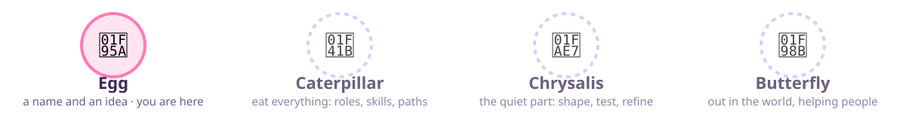

<p align="center">
  
</p>

<p align="center">
  
  
  
</p>

<h1 align="center">careerpillar</h1>

<p align="center"><strong>A career explorer.</strong><br>
Log the work you actually did, map it to a competency matrix, work out what kind of engineer you want to become, and walk into your review with receipts.</p>

<p align="center">
  <a href="https://tiffanyjachja.github.io/careerpillar/"><strong>🦋 tiffanyjachja.github.io/careerpillar</strong></a>
</p>

<p align="center">
  <a href="https://tiffanyjachja.github.io/careerpillar/">Landing page</a> · <a href="https://tiffanyjachja.github.io/careerpillar/app.html">Dashboard</a> · <a href="#skills">Skills</a> · <a href="#customizing-for-your-company">Bring your own ladder</a>
</p>

---

## Why this exists

Career ladders tell you how to climb. They rarely tell you who to become, or where you are standing right now.

careerpillar starts from the person, not the rung. You bring the work you did. It shows which competencies that work already covers, where the gaps are against your target level, what kind of senior or staff engineer you are turning into, and the smallest next move. When review season comes, it writes the packet from your evidence.

It grew out of years of coaching people making their first moves in tech, and out of running real promotion cycles as an engineering manager. The packets that survive a committee all have the same bones: real dates, named stakeholders, a number or an honest "none", and a link for everything. The skills enforce those bones.

Everything stays on your machine. The dashboard keeps data in your browser's local storage, and the skills read and write one JSON file in your home directory. Nothing is uploaded anywhere.

## What's included

| Path | Purpose |
|---|---|
| `index.html` | Landing page. A scroll-driven tour of the project. Live at [tiffanyjachja.github.io/careerpillar](https://tiffanyjachja.github.io/careerpillar/). |
| `app.html` | Visual dashboard. Open it in any browser, no server needed, or use the [hosted copy](https://tiffanyjachja.github.io/careerpillar/app.html). Data stays in your browser either way. |
| `plugins/careerpillar/` | Claude Code plugin with thirteen skills (`/careerpillar:*`) |
| `plugins/careerpillar/matrix.js` | The default competency matrix, shared by the dashboard and the skills |
| `plugins/careerpillar/packet-template.md` | Default promotion-packet sections; override with your company's form |
| `plugins/careerpillar/paths.md` | Shapes of senior and staff work used by the career explorer, with sources |
| `plugins/careerpillar/paths.js` | The same shapes as data, for the dashboard's Explore page |
| `plugins/careerpillar/values.md` | The values sort: method, stance, and how to read the result |
| `plugins/careerpillar/strengths.md` | Twenty plain-language working patterns, with standing and combinations |
| `plugins/careerpillar/compass.js` | Values and strengths as data, shared by the dashboard and the skills |
| `plugins/careerpillar/SCHEMA.md` | The profile JSON schema, the XYZ entry shape, and the quality rules |
| `plugins/careerpillar/impact-ladder.md` | The follow-up-question method (output → outcome → beneficiary → evidence → counterfactual → what it unlocked) used by manager-review, log, and peer-review |
| `plugins/careerpillar/hooks/`, `scripts/check-profile.js` | Hook that enforces the entry shape on every profile write; also a CLI checker |

## Getting started

### Option A: Browser dashboard

1. Clone or download this repo.
2. Open `app.html` in your browser. A `file://` URL is fine.
3. Fill out the setup screen: name, track (IC or Manager), current level, target level.
4. Log accomplishments, view competency coverage, export your profile.
5. Open **Explore** to work out what kind of senior or staff engineer you want to become.

To hand the data to the Claude Code skills, click **Export Profile** and save the file as `~/careerpillar-profile.json`.

### Option B: Claude Code plugin

Install from this repo as a plugin marketplace:

```bash
claude plugin marketplace add tiffanyjachja/careerpillar
claude plugin install careerpillar@careerpillar
```

Or inside a Claude Code session:

```
/plugin marketplace add tiffanyjachja/careerpillar
/plugin install careerpillar@careerpillar
```

Then run:

```
/careerpillar:load
```

Claude walks you through setup if you have no profile yet, or resumes your session if you do. To reconstruct months of history from merged pull requests, run `/careerpillar:backfill` (uses the `gh` CLI, or a GitHub tool if one is connected).

To develop the skills locally without installing, start Claude Code with the plugin directory:

```bash
claude --plugin-dir ./plugins/careerpillar
```

## The metamorphosis

<p align="center">
  
</p>

The four stages are also how the tool is organized. Each maps to a handful of skills.

| Stage | What happens | Skills |
|---|---|---|
| 🥚 **Egg** | Log it while it's warm | `log`, `backfill` |
| 🐛 **Caterpillar** | Eat everything, map everything | `status`, `suggest`, `vibe-check` |
| 🫧 **Chrysalis** | Find your shape | `explore`, `values`, `strengths` |
| 🦋 **Butterfly** | Make the case | `export`, `manager-review`, `peer-review`, `peer-feedback` |

## Skills

| Command | What it does |
|---|---|
| `/careerpillar:load` | Start or resume a session; shows where you left off |
| `/careerpillar:log` | Log a new accomplishment conversationally: real work date, beneficiaries, a number or an explicit "none", stakeholders, evidence links |
| `/careerpillar:backfill` | Reconstruct history from merged PRs and issues: real dates, one link per piece of evidence, reviewers as stakeholders, confirmed in batches |
| `/careerpillar:explore` | Career explorer: what kind of senior or staff engineer do you want to become, what that means here, and 90-day experiments to test it |
| `/careerpillar:values` | Values sort: 35 cards down to the two you would defend when they cost you something, what you do not tolerate, and a living-it behavior for each |
| `/careerpillar:strengths` | Working strengths: pick five of twenty plain-language patterns, each with a story, a shadow, and what to ask for |
| `/careerpillar:status` | Competency coverage snapshot and gap analysis toward your target level |
| `/careerpillar:suggest` | Prioritized advice on what to focus on next: pattern analysis, scope signals, one concrete action |
| `/careerpillar:export` | Generate a promotion packet (from a pluggable template, with a References section), performance review, or self-review summary |
| `/careerpillar:vibe-check` | Quarterly pulse check across 8 dimensions; produces a snapshot and one concrete action |
| `/careerpillar:manager-review` | Review a direct report's tracker as their sponsor: intake on the business context, triage, an impact dig (one follow-up question at a time until the impact and the level are clear), then bullets, growth lens, 7-point promo-readiness check, and a write-back that leaves the tracker better |
| `/careerpillar:peer-review` | Write a 360-style performance review; collects peer input conversationally, produces a sponsor-quality document |
| `/careerpillar:peer-feedback` | Managers: plan who to ask for packet feedback, draft the ask, track status, store quotes verbatim |

## The profile file

The dashboard and the skills share one file: `~/careerpillar-profile.json`.

- **Browser to CLI**: Export from the dashboard, save as `~/careerpillar-profile.json`.
- **CLI to browser**: The skills write to that file directly. Import it back into the dashboard with **Import Profile**.

```json
{
  "profile": {
    "name": "Your Name",
    "currentLevel": "IC4",
    "targetLevel": "IC5",
    "track": "IC"
  },
  "accomplishments": [],
  "customStakeholders": []
}
```

Each accomplishment has `id`, `date` (when the work landed), `loggedAt`, `title`, `action`, `impact`, `metrics`, `competencies`, `level` (self-assessed), optional `assessedLevel`, `stakeholders`, `links` (one object per piece of evidence), and `tags`. The profile also holds `peerFeedback[]` and an optional `careerDirection`. Full schema and quality rules: [`plugins/careerpillar/SCHEMA.md`](plugins/careerpillar/SCHEMA.md).

If you used this project under its previous name, the skills still read `~/eng-tracker-profile.json` and the matching override files until you rename them.

Every entry follows one shape: **accomplished X, as measured by Y, by doing Z.** A plugin hook checks the profile each time Claude Code writes it, blocks writes that break the shape or duplicate an existing entry, flags entries that should be bundled or given a time span, and hands back the list of what to fix. The same checker runs by hand with `node plugins/careerpillar/scripts/check-profile.js ~/careerpillar-profile.json`. Details in [`SCHEMA.md`](plugins/careerpillar/SCHEMA.md).

Profile files contain real performance information about real people. The repo's `.gitignore` excludes `*profile*.json`; keep it that way.

## The competency matrix

**IC track:** Scope · Delivery · Design & Architecture · Collaboration & Citizenship · Process Improvement (levels IC2 to IC8)

**Manager track:** Scope · Delivery · Collaboration & Citizenship · Process Improvement · Technical Strategy · Team Building (levels M3 to M6)

Coverage is rated **STRONG** (3+ entries), **THIN** (1 to 2), or **GAP** (0) against the descriptors for your target level.

The default matrix in `plugins/careerpillar/matrix.js` is a generic, industry-style ladder written in plain language. It is not any one company's leveling document.

### Using your company's matrix

Write a JSON file with the same shape as `DEFAULT_MATRIX`:

```json
{
  "IC": { "Scope": { "IC3": "...", "IC4": "..." }, "Delivery": { "...": "..." } },
  "Manager": { "Scope": { "M3": "...", "M4": "..." } }
}
```

Then:

- **Dashboard:** open the profile menu (your initial, top right) and choose **Import company matrix**. The file is stored in your browser only; **Use default matrix** removes it. Add an optional `levelNames` object (`{ "IC": { "IC4": "Senior Software Engineer" }, "Manager": { ... } }`) to show your company's titles next to the level keys.
- **Skills:** save the same file as `~/careerpillar-matrix.json`. Every skill checks for it before falling back to the default.

Keep company leveling documents out of this repo. The matrix file is already in `.gitignore`.

## Customizing for your company

Three optional files in your home directory override the defaults. None of them belong in a public repo.

| File | Replaces | Used by |
|---|---|---|
| `~/careerpillar-matrix.json` | the competency matrix and optional level titles | all skills (dashboard: profile menu → **Import company matrix**) |
| `~/careerpillar-packet-template.md` | promotion-packet sections and prompts | `/careerpillar:export promo` |
| `~/careerpillar-paths.md` | role names and definitions for the career explorer | `/careerpillar:explore` |

## Career explorer

Most ladders tell you how to reach the next level, not what kind of engineer to become there. The explorer exists for that question, in two places, and it comes with two companions: a values sort and a working-strengths picker.

**In the dashboard (Explore page):** reads your logged work and shows where it already points across the four staff archetypes plus breadth-building and management; flags the premature-senior pattern, missing stakeholders, and back-filled dates; lets you open each shape to see the week, where it exists, what it means at your target level quoted from the matrix, what it does not mean, and which of your entries read as that shape; asks six reflection questions saved to your profile; and lets you choose a direction, write a hypothesis, and set 90-day experiments. **Copy for my 1:1** turns it into text to bring to your manager.

**In Claude Code:** `/careerpillar:explore` reads the shape of your logged work, asks what kind of week you want, and gives you a hypothesis about what kind of senior or staff engineer you are becoming, what that means at your target level, what it does not mean, whether the opportunity exists where you are, and two or three 90-day experiments to test it. It draws on Will Larson's staff archetypes, Charity Majors's writing on levels and the premature-senior trap, and Gergely Orosz's career-path writing; sources are listed in `plugins/careerpillar/paths.md`. Staying senior and moving into management are treated as legitimate answers.

**Values.** A narrowing sort of 35 work values: everything that resonates, then ten, then five, then two core values you would defend when they cost you something. Then what you do not tolerate, one behavior that shows you are living each core value, and the early sign you are slipping. The two-value idea is adapted from Brené Brown's exercise; the cards are original. On the dashboard's Explore page and as `/careerpillar:values`.

**Strengths.** Twenty plain-language working patterns in four families (Drive, Influence, Connection, Insight). Pick five with a story each; see what each looks like at its best and running hot, and what to ask for. Your log is checked for each pattern. This is informal coaching material written for this project, not a validated instrument, and it is not affiliated with any commercial strengths assessment. On the Explore page and as `/careerpillar:strengths`.

Both save into `careerDirection` in your profile, and `explore`, `suggest`, and `export` read them.

## Principles

1. **Start where the person is.** No form that assumes you already know the answer. Leadership, in the author's words, is anyone who holds themselves accountable for finding potential in people and processes. The tool is built to find it, not to grade it.
2. **Adjacent beats aspirational.** The best next step is the one you can take this quarter.
3. **Receipts or it didn't happen.** Real dates, named stakeholders, a number or an honest "none", a link.
4. **Senior is a real destination.** Staying senior, going staff, or moving into management all count.

## Requirements

- **Landing page and dashboard:** any modern browser. No dependencies, no install.
- **Skills:** [Claude Code](https://claude.ai/code).

## Contributing

Issues and pull requests are welcome. Before opening a PR, run:

```bash
claude plugin validate .
claude plugin validate plugins/careerpillar
```

Please do not include real names, company-internal URLs, or leveling documents in examples or tests.

## License

[Apache License 2.0](LICENSE)

---

<p align="center">
  Made by <a href="https://jachja.com">Tiffany Jachja</a> · 🐛 → 🦋
</p>
